<div align="center">

# 鹿途AI·拾光画境

### lutuAI MuseFrame

**把喜欢的瞬间，画成值得收藏的模样。**

照片艺术转绘 · 十二款材质配方 · 十二组同源对照 · 系列统一

[效果预览](#效果预览) · [快速开始](#快速开始) · [风格库](#风格库) · [批量准备](#批量准备) · [许可](#许可与致谢)

</div>

---

**鹿途AI·拾光画境** 是一个面向 AI 助手的照片艺术转绘技能。提供一张照片，用一句话选择风格，就能让助手将旅行照、宠物照、人像或生活静物转成具有水粉、纸雕、孔版印刷等材质感的画面。

它从原图出发，先记录主体特征，再组织提示词、调用图片工具，并对照检查结果。默认保留原图构图；需要制作海报时，也支持明确指定改比例、留白和重排。

> 这是一个技能包，需要配合能接收原图的图片生成或编辑工具使用。它不内置图像模型；没有合适工具时，会提供提示词并说明尚未出图。

## 效果预览

同一个海边下午，十二种材质表达。每款风格均将同一张合成原图与处理结果并排展示，便于比较笔触、色彩与材质的变化。

### 01 · 海盐手绘 · Coast Gouache

哑光水粉、平刷色块与局部干刷，让海边日光呈现柔和的手绘质感。

| 合成输入图 | 风格处理后 |
| :---: | :---: |
| 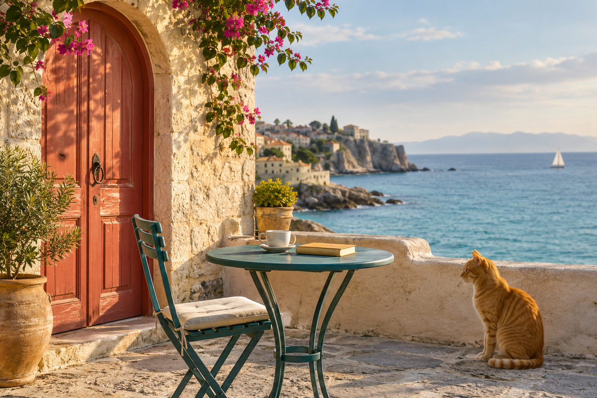 | 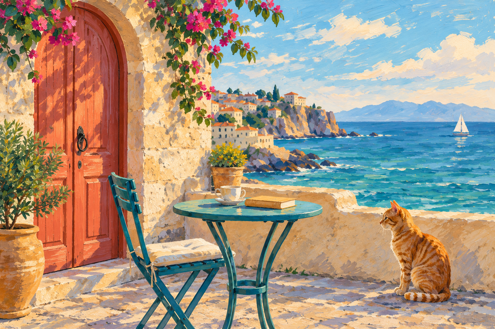 |

### 02 · 纸雕剧场 · Paper Theatre

层叠纸片、切口与细微投影，把场景组织成有纵深的纸艺画面。

| 合成输入图 | 风格处理后 |
| :---: | :---: |
|  | 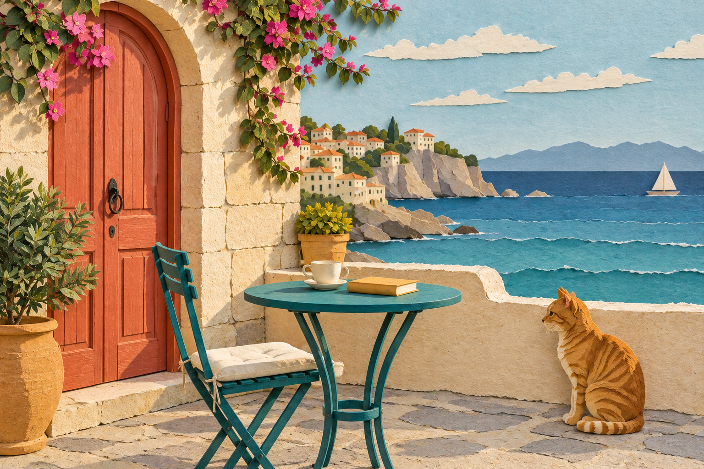 |

### 03 · 周末孔版 · Risograph Weekend

有限色版、吸墨纸颗粒与轻微套印偏移，带来独立印刷品的质感。

| 合成输入图 | 风格处理后 |
| :---: | :---: |
|  | 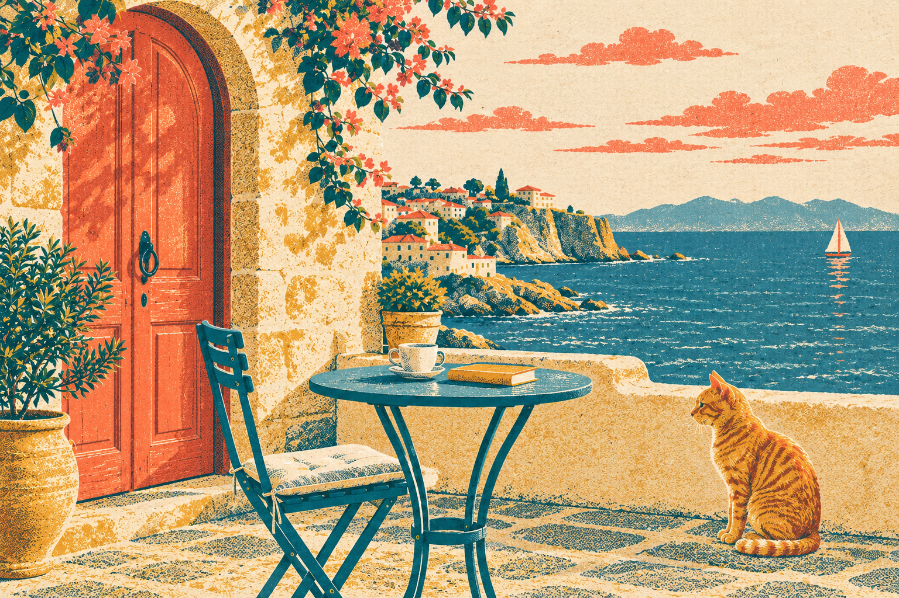 |

### 04 · 墨彩潮汐 · Ink Tide

墨色浓淡、吸水纸纹与受控洇化，让轮廓和色彩在纸面自然交融。

| 合成输入图 | 风格处理后 |
| :---: | :---: |
|  | 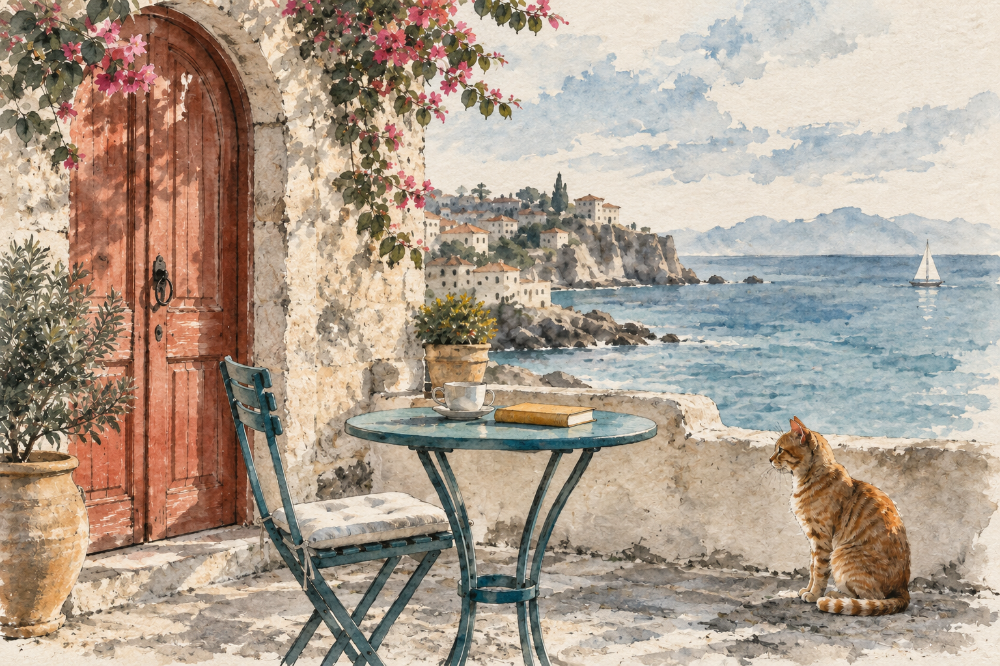 |

### 05 · 织光记忆 · Woven Memory

随形针脚、细线束与织物毛羽，将光影转成温暖的纺织纹理。

| 合成输入图 | 风格处理后 |
| :---: | :---: |
|  | 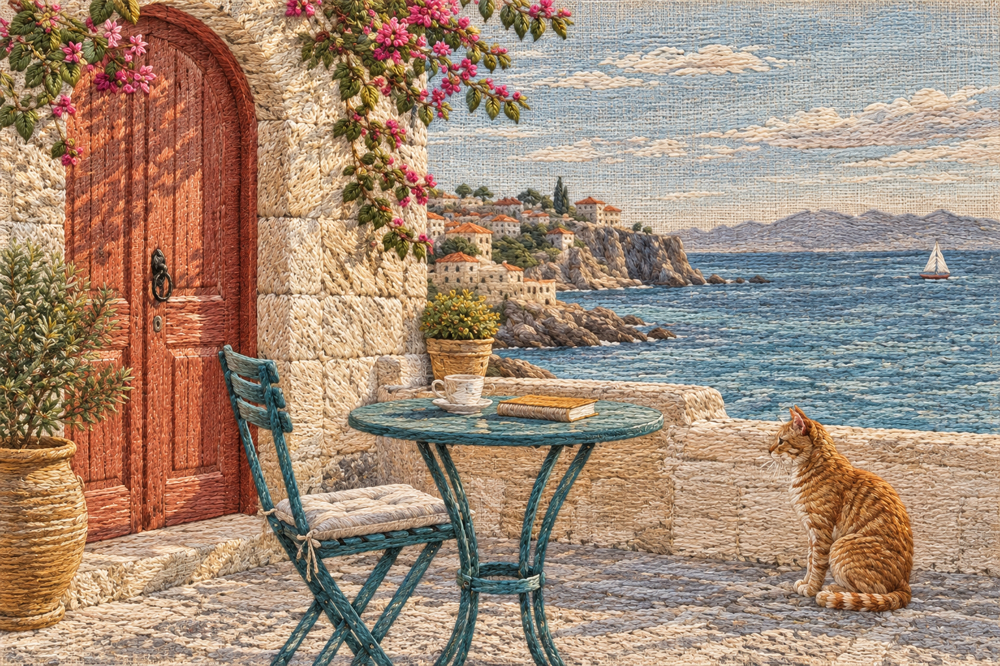 |

### 06 · 铅笔停格 · Graphite Pause

石墨排线、擦提亮部与纸面齿纹，以黑白明暗记录场景的细节。

| 合成输入图 | 风格处理后 |
| :---: | :---: |
|  | 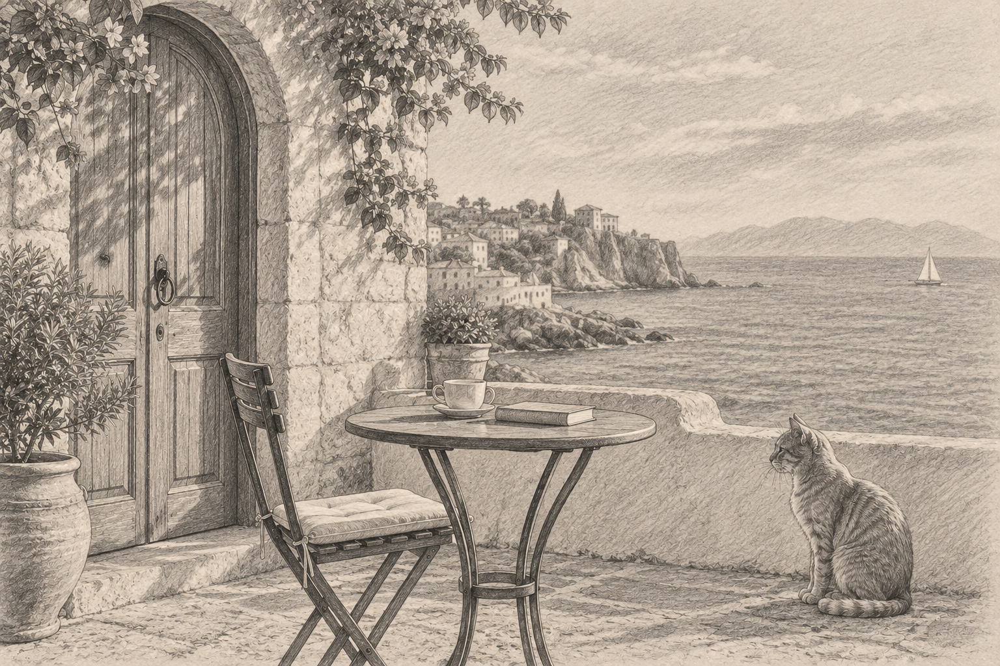 |

### 07 · 窗边油彩 · Window Oil

厚薄相间的颜料、短笔触与画布纹理，突出色面和光影的层次。

| 合成输入图 | 风格处理后 |
| :---: | :---: |
|  | 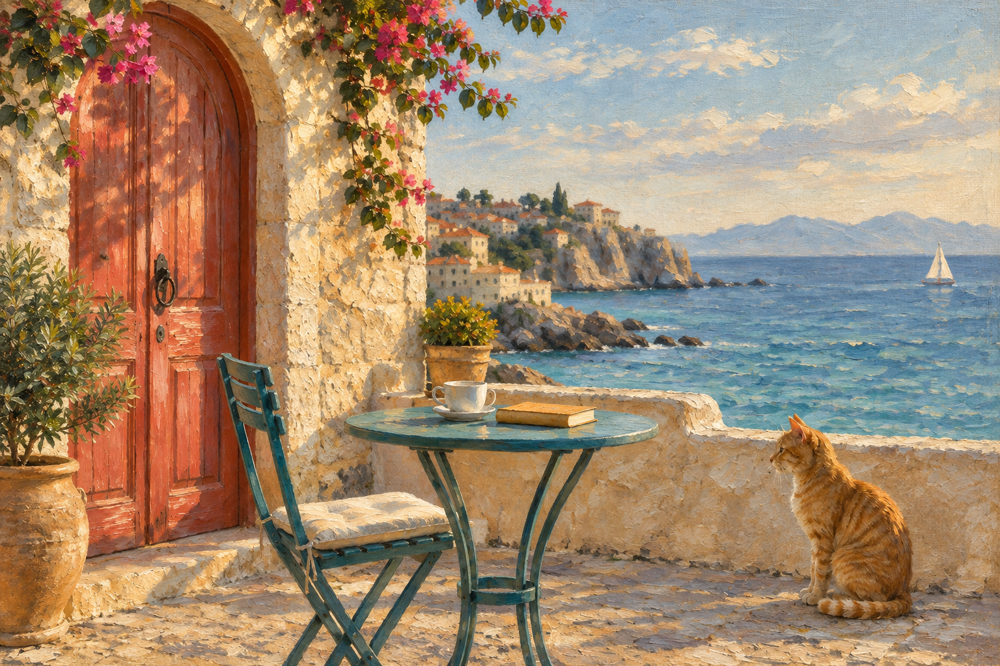 |

### 08 · 陶土晴日 · Clay Day

无釉色泥、轻微压痕与浅刻线，将熟悉的物件塑成手作陶土场景。

| 合成输入图 | 风格处理后 |
| :---: | :---: |
|  | 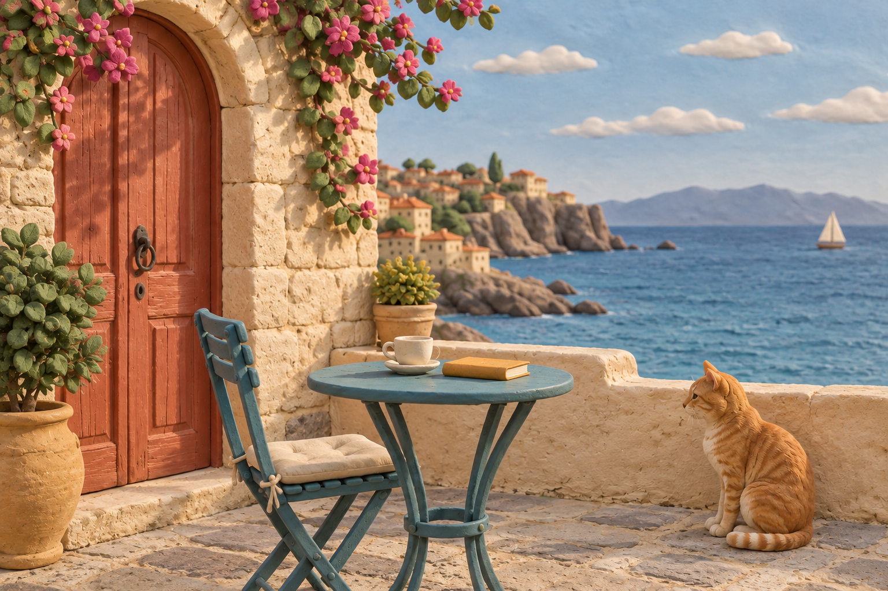 |

### 09 · 琥珀胶片 · Amber Film

细颗粒、柔和高光与轻微光晕，为日常光线增添温润的胶片气息。

| 合成输入图 | 风格处理后 |
| :---: | :---: |
|  | 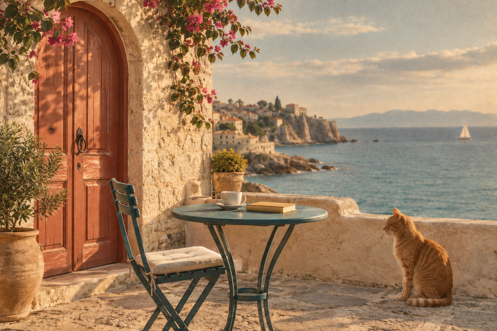 |

### 10 · 呼吸线稿 · Quiet Contour

变化的线宽、断续轮廓与克制留白，留下场景中最有辨识度的结构。

| 合成输入图 | 风格处理后 |
| :---: | :---: |
|  | 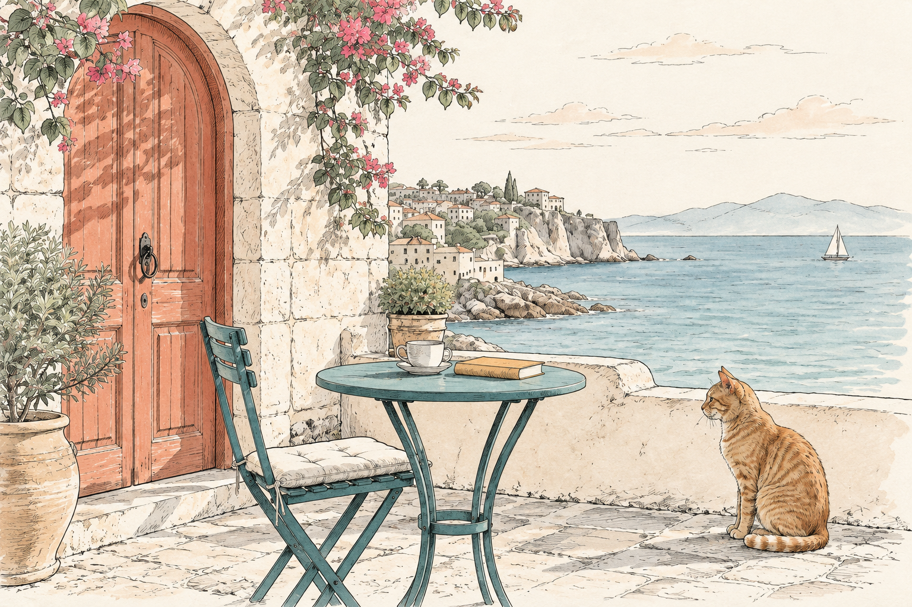 |

### 11 · 野集拼贴 · Field Collage

撕边、剪切边与薄纸叠贴，以不同纸材拼出色彩和空间关系。

| 合成输入图 | 风格处理后 |
| :---: | :---: |
|  | 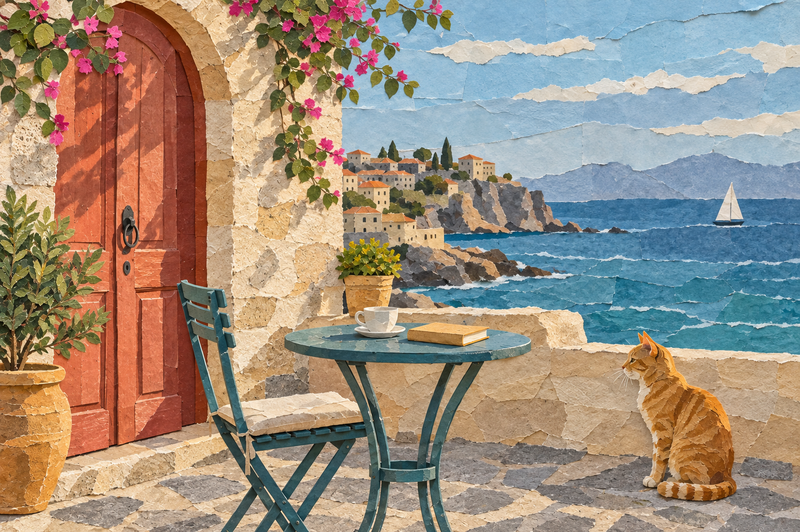 |

### 12 · 夜色粉彩 · Night Pastel

粉彩颗粒、短色点与侧锋铺色，保留原图时段并柔化色彩交界。

| 合成输入图 | 风格处理后 |
| :---: | :---: |
|  | 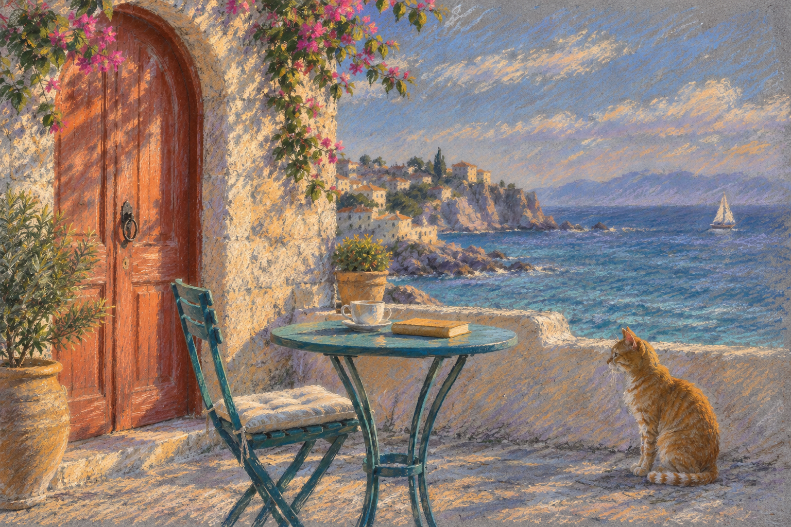 |

以上十三张图片均为本项目重新生成的 AI 演示素材，场景为虚构。十二张转绘分别以同一张合成输入图为参考生成，未使用上游示例图片。十二款均提供实际转绘示例；检查记录见[素材说明](assets/ASSET_NOTES.md)。

仓库附带 [交互展示页源码](index.html)，支持风格切换、拖动对照和指令复制。下载完整目录后，使用浏览器打开 `index.html` 即可体验；在 GitHub 仓库中点击该文件，看到的是源码。

## 可以做什么

| 场景 | 使用方式 |
| --- | --- |
| 一张照片转成收藏画 | 指定喜欢的材质，或让助手根据画面推荐 |
| 同一张图尝试多种风格 | 每个版本都从原图开始，便于比较效果 |
| 一组照片做成系列 | 统一配方、色板和笔触，默认保留各自原图比例 |
| 保留在意的细节 | 强调人物表情、宠物花纹、建筑轮廓或关键物件 |
| 制作海报底图 | 明确指定画幅、留白位置和允许的构图调整 |
| 准备可复用的任务 | 保存提示词与任务清单，交给图片工具逐项执行 |

每次转绘都会检查主体数量、辨识特征、空间关系和材质表现。发现问题后优先做针对性修正；无法解决的偏差会随结果说明。

## 快速开始

### 1. 安装技能

下载本仓库的完整内容，将文件夹命名为 `lutuai-museframe`，放入助手的技能目录。请保留图片、配方和脚本等子目录，不要只复制 `SKILL.md`。

以 Codex 为例：

| 系统 | 默认安装位置 |
| --- | --- |
| Windows | `%USERPROFILE%\.codex\skills\lutuai-museframe\` |
| macOS / Linux | `~/.codex/skills/lutuai-museframe/` |

如果设置了 `CODEX_HOME`，请使用其下的 `skills/lutuai-museframe/`。安装后的入口应位于 `lutuai-museframe/SKILL.md`，避免多套一层同名文件夹。重新打开任务，让助手发现技能。

其他支持 `SKILL.md` 的助手可按其技能加载方式接入；具体的图片工具调用能力由宿主环境决定。

### 2. 上传照片并发出指令

```text
使用 $lutuai-museframe，把这张照片转成海盐手绘。
保留原图比例、主体特征和构图，不添加文字。
```

也可以附带风格参考，并说明哪张负责内容、哪张只参考材质。日常使用不需要运行 Python；Python 仅用于下方可选的批量准备工具。

## 常用指令

**还没想好风格**

```text
使用 $lutuai-museframe，帮我看看这张照片适合哪三种风格。
先给建议，暂时不要生成图片。
```

**宠物画像**

```text
使用 $lutuai-museframe，把这张猫咪照片做成织光记忆。
保留眼睛颜色、毛色和斑纹，不改变姿势。
```

**同图多风格**

```text
使用 $lutuai-museframe，把这张照片分别做成海盐手绘、纸雕剧场、周末孔版。
三张都以原始照片为输入，保留同样的取景范围。
```

**旅行照系列**

```text
使用 $lutuai-museframe，把这组三张旅行照做成海盐手绘系列。
统一色板、笔触与转绘强度，保留每张照片原有的比例和内容。
```

**海报底图**

```text
使用 $lutuai-museframe，把照片做成 3:4 纸雕风海报底图。
允许重排构图，上方留标题空间，暂时不要加字。
```

## 风格库

| 风格 | ID | 适合的内容 | 材质特点 |
| --- | --- | --- | --- |
| 海盐手绘 | `coast-gouache` | 旅行、日光人像、宠物 | 哑光水粉、平刷色块、局部干刷 |
| 纸雕剧场 | `paper-theatre` | 合照、建筑、室内 | 层叠纸面、切口、细微投影 |
| 周末孔版 | `risograph-weekend` | 街拍、出游、运动 | 限色套印、吸墨纸、疏密网点 |
| 墨彩潮汐 | `ink-tide` | 山水、庭院、花木 | 墨色层次、吸水纸、受控洇化 |
| 织光记忆 | `woven-memory` | 家庭、宠物、温馨室内 | 随形针脚、细线束、织物毛羽 |
| 铅笔停格 | `graphite-pause` | 肖像、成长记录、建筑局部 | 石墨排线、擦提亮部、纸面齿纹 |
| 窗边油彩 | `window-oil` | 人物、餐桌、街角光影 | 厚薄颜料、短笔触、画布纹理 |
| 陶土晴日 | `clay-day` | 人物、宠物、食物 | 无釉色泥、压痕、浅刻线 |
| 琥珀胶片 | `amber-film` | 街头、纪实、生活瞬间 | 细颗粒、柔和高光、轻微光晕 |
| 呼吸线稿 | `quiet-contour` | 家庭、情侣、建筑、静物 | 变化线宽、断续轮廓、克制留白 |
| 野集拼贴 | `field-collage` | 旅行、花草、城市 | 撕边、剪切边、薄纸叠贴 |
| 夜色粉彩 | `night-pastel` | 黄昏、夜景、雨后街景 | 粉彩颗粒、短色点、侧锋铺色 |

名称描述材料与色彩气质，不会自动添加对应场景。例如，“海盐手绘”不会给室内照片补上海洋，“夜色粉彩”不会默认把白天变成夜晚。

完整选型说明见 [风格指南](references/style-guide.md)，结构化配方见 [styles.json](references/styles.json)。也可以直接描述自己的风格需求。

## 转绘强度与构图

| 强度 | 适合的目标 |
| --- | --- |
| 轻转绘 · `low` | 以色彩、纸面与笔触变化为主，尽量保留细节 |
| 平衡转绘 · `medium` | 默认；材质变化明显，主体和空间关系清楚 |
| 强转绘 · `high` | 更大胆地简化色面与背景纹理，仍保留主体身份与数量 |

强度表示自然语言编辑意图，不对应某个模型固定的参数数值。

- **原构图转绘**：默认模式，保留画幅、取景、主体位置和主要轮廓。
- **海报重排**：在用户要求改比例、调整裁切或增加留白时使用。

原图负责内容与身份，风格参考负责材质与笔触。参考图中的人物、建筑和道具不应进入成品。

## 批量准备

可选工具 `scripts/prepare_job.py` 仅使用 Python 标准库，建议 **Python 3.9+**，无需额外安装依赖。以下命令均在本仓库根目录运行。

**查看全部风格：**

```bash
python scripts/prepare_job.py --list-styles
```

**使用仓库自带图片，准备两种风格的任务：**

```bash
python scripts/prepare_job.py --input "assets/demo/source-coastal-reading.png" --style coast-gouache --style paper-theatre --output "jobs/demo"
```

**准备海报重排任务：**

```bash
python scripts/prepare_job.py --input "assets/demo/source-coastal-reading.png" --style paper-theatre --layout poster --ratio 3:4 --output "jobs/poster"
```

将 `--input` 后的路径替换成自己的照片即可。多张照片重复使用 `--input`，多个风格重复使用 `--style`，工具会创建“源图 × 风格”的组合任务。

| 参数 | 说明 |
| --- | --- |
| `--input` | 源图路径，支持 PNG、JPG、JPEG、WebP；可重复 |
| `--style` | 风格 ID；可重复 |
| `--strength` | `low`、`medium`、`high`；默认 `medium` |
| `--layout` | `preserve` 或 `poster`；默认 `preserve` |
| `--ratio` | `source`、`1:1`、`3:4`、`4:5`、`16:9`、`9:16`；默认 `source` |
| `--anchors` | UTF-8 文本文件，记录需要保留的主体特征 |
| `--output` | 不存在或为空的输出目录 |

改比例需要同时选择 `--layout poster`。`--anchors` 的说明会用于所有输入图；各张照片的主体说明不同时，请分别创建任务。图片输入只做文件头与扩展名检查，实际解码由图片工具完成。

```text
jobs/demo/
├── job.json       # 待执行任务与源图映射
├── prompts/       # 每个任务的编辑提示词
└── images/        # 留给实际图片工具保存结果，初始为空
```

**该脚本只准备任务，不生成图片。** `job.json` 初始状态为 `awaiting_image_tool`，每项任务为 `pending`。实际执行时，仍需将源图传给支持图片输入的工具。

## 目录结构

```text
lutuai-museframe/
├── SKILL.md                    # 技能入口与工作流程
├── README.md                   # 项目介绍与使用说明
├── index.html                  # 本地交互展示页
├── agents/openai.yaml          # 助手界面元数据
├── references/
│   ├── styles.json             # 十二套结构化风格配方
│   ├── style-guide.md          # 选型与强度说明
│   └── workflow.md             # 提示词与验收模板
├── scripts/prepare_job.py      # 批量任务准备工具
├── tests/test_prepare_job.py   # 标准库测试
├── assets/
│   ├── demo/                   # 合成输入图与十二张转绘图
│   ├── generation-prompts.json # 演示图片的生成提示词
│   ├── manifest.json           # 图片尺寸与文件摘要
│   └── ASSET_NOTES.md          # 素材说明及检查记录
├── LICENSE                     # 本版本代码与文档许可
├── LICENSE.upstream            # 保留的上游许可
└── NOTICE.md                   # 来源与改造说明
```

## 常见问题

**为什么没有直接出图？**

请确认助手已配置能接收原图的图片工具。只有纯文字生图能力时，无法执行本技能的照片转绘流程；技能会先交付提示词，不会将其标记为已生成图片。

**可以保证人物完全不变吗？**

不能保证。技能通过主体记录、原图输入和对照验收减少偏差，结果仍取决于模型能力。多人合影、人脸、手部、精确文字和建筑细节需要重点检查。当前演示不含人像，未验证真实人物的身份保持效果。

**照片会自动公开吗？**

技能不会自行发布照片。实际生成时，图片会交给你使用的图像服务处理，具体的数据处理方式取决于该服务。

**是否需要额外的 API 密钥？**

技能优先使用助手已配置的图片能力，不会自动申请或索取密钥。是否需要密钥、是否收费，由所用服务决定。

## 开发与贡献

欢迎提交新的材质配方、可复现的问题报告和流程改进。新增配方请保持 `references/styles.json` 的字段结构，写清适合题材、材质特征、主体保留要求与应避免的问题。

运行批量工具测试：

```bash
python -m unittest discover -s tests -v
```

当前包含 11 项测试，覆盖任务组合、源文件保护、无效图片、未知风格、比例冲突和输出目录保护。脚本测试验证任务准备行为，不代替图片效果评估。

分享案例时，请使用有权公开的图片，说明输入和风格，并标明 AI 生成或编辑。

## 许可与致谢

本版本代码与文档采用 [MIT License](LICENSE)。照片转绘工作流参考并改造自 [iotate/photo-story](https://github.com/iotate/photo-story)，感谢上游项目的开放分享。上游许可保留于 [LICENSE.upstream](LICENSE.upstream)，来源与改造范围见 [NOTICE.md](NOTICE.md)。

本版本重新编写了技能入口、风格配方、验收流程、批量准备工具与展示页面，并重新生成演示素材。AI 图像的使用说明见 [素材说明](assets/ASSET_NOTES.md)；分发本项目时，请一并保留许可及相关说明。
